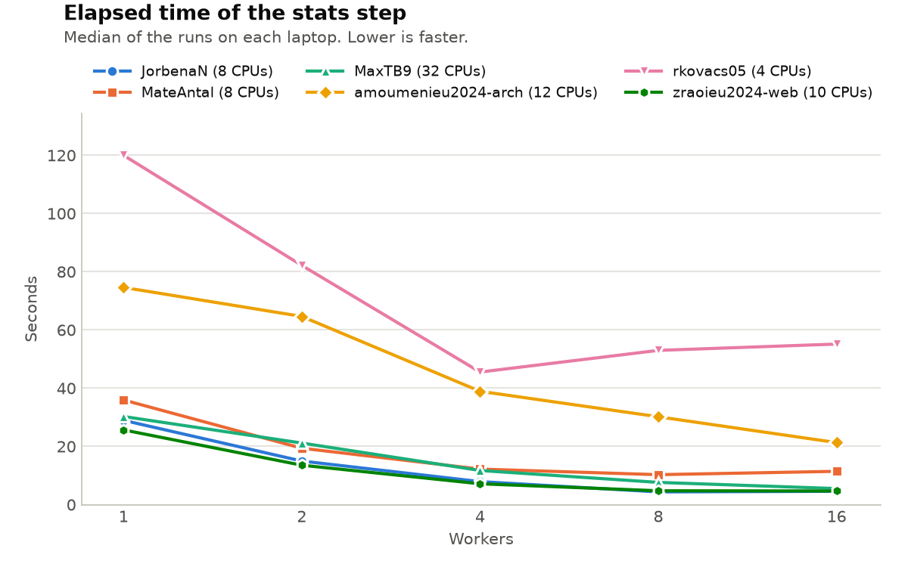

# Lab 1: The Nightly Report

Write your answers in this file. Keep them short: a few sentences, the commands
you used, and the numbers you measured. Copy the lines of output that matter,
not whole screens.

## Warm-up: Generating the report

- What happened, and why:

One of the programs didn't run. (report.py). The OOM killer killed the program.
There was also a problem with the permissions, as execute was not allowed.

- Your fix, and how it reached your teammates:

The fix is the following command:
 git update-index --chmod=+x run_report.sh
This command was pushed to github and then the teammates could pull it.

## Task 1: Generating the report… again

(fix and text by Renáta Kovács)

- Symptom: revenue_by_region_by_month.csv doesn't get generated

- Commands and recordings you used, why you chose them, and what they showed:

Ran run_report.sh with the time recording to see the before time:
/usr/bin/time -f "$T" ./run_report.sh

Printed out the files that were generated:
ls -l ~/data/out ~/data/out/extracts

Found that the revenue_by_region_by_month.csv file from the reports was not generated.

Tried to run report.py on its own and it got killed:
python3 steps/report.py

Echo is 137

Figured out that the OOM killer stopped the program:
cat /sys/fs/cgroup/memory.events
oom_kill is 4

- Cause: report.py gets killed by the OOM killer

- Fix: The file is oly loaded once and only the columns that are used are loaded. The datatypes for these columns are also given; therefore, they take up less memory and the OOM killer doesn't kill the program.

- Before and after (your measurements):

Before:
550.46 s elapsed, 436.62 s user, 270.70 s system, 2090032 KB peak memory

With 1 million orders:
5.36 s elapsed, 3.82 s user, 1.37 s system, 505220 KB peak memory

With 2 million orders:
8.22 s elapsed, 6.75 s user, 1.68 s system, 856076 KB peak memory

With 4 million orders:
15.33 s elapsed, 12.36 s user, 3.18 s system, 1570440 KB peak memory

After:
13.50 s elapsed, 10.26 s user, 3.10 s system, 1289476 KB peak memory

## Task 2: Extracting data

(Fix and text by Mate Antal, explained by Claude)

- Symptom: `steps/extracts.sh` printed `extracts: done` and exited with status 0, but all six `extracts/REGION.csv` files were 0 bytes. `tools/check.py`: `extracts/Iberia.csv  0 rows, expected 2,183,057` (same for every region).
- Commands and recordings you used, why you chose them, and what they showed:
  - `bash steps/extracts.sh; echo $?` → `0`: the script reported success.
  - `less steps/extracts.sh`: the script does `cd "$OUT/extracts"`, then reads `../data/sales_2025.csv` with `2>/dev/null` after `grep`.
  - Ran the pipeline by hand from that folder, without `2>/dev/null`:
    `cd ~/data/out/extracts; grep ",Iberia," ../data/sales_2025.csv | cut -d, -f1,2,4,6,7 | wc -l` → `grep: ../data/sales_2025.csv: No such file or directory`, count `0`.
    `echo ${PIPESTATUS[@]}` → `2 0 0` (grep failed with 2, cut and wc returned 0). `pwd` → `/home/analyst/data/out/extracts`.
- Cause: `../data/sales_2025.csv` is a relative path, resolved from the working directory. After the `cd`, it names `~/data/out/data/sales_2025.csv`, which does not exist. `2>/dev/null` threw away grep's error message, `> "$region.csv"` had already created each file empty, the pipeline's status was cut's (0) and the script's status was the final `echo`'s (0). The script also ignored the `DATA` variable.
- Fix: added `set -euo pipefail` (stop on any failed command, on unset variables, and on a failure anywhere in a pipeline); read the input from `DATA=${DATA:-$HOME/data/sales_2025.csv}`, made absolute with `realpath` before the `cd`; removed `2>/dev/null`. Checked: `DATA=/nonexistent.csv bash steps/extracts.sh` now stops with `grep: /nonexistent.csv: No such file or directory`, exit status 2. `cd ~ && bash work/ospc-lab1-a8/steps/extracts.sh` works from another folder.
- Before and after (your measurements), Mate Antal, MacBook Air M1:

  | | Elapsed | User | System | Peak memory | Result |
  |---|---|---|---|---|---|
  | Before | 0.03 s | 0.01 s | 0.03 s | 8,636 KB | 6 empty files, exit 0 |
  | After | 4.17 s | 5.09 s | 1.12 s | 6,564 KB | `check.py`: PASS for all 6 extracts, exit 0 |

  "After" is slower because it now reads the 498 MB file (six times); "before" read nothing. User > elapsed because grep and cut run as two processes at the same time. Peak memory stays tiny because grep and cut stream the file line by line.

## Task 3: Auditing

- Symptom: `audit.py` takes 40.7 s on the whole file, against 9.5 s after the
  fix, and its time is not only in its own code: 11.2 s of it is system time.

- Commands and recordings: We used `/usr/bin/time -v` to measure elapsed time, user CPU time, system CPU time, and peak memory. We used `strace -c -f` to examine the number and types of system calls.

  Commands used for the optimized version:

  bash
  /usr/bin/time -v -o /tmp/audit_before.txt python3 steps/audit.py
  strace -c -f -o /tmp/audit_strace.txt python3 steps/audit.py
  python3 tools/check.py
  ```

- Cause: The original implementation repeatedly opened and closed the audit output file while processing individual orders. This produced excessive file-related operations and unnecessary system calls.

- Fix: The optimized implementation opens the output file once with `with open(path, "w") as f:`, writes the records using buffered output, and closes the file after processing. This reduces file-opening overhead and the number of system calls.

- Before and after measurements:

  | Metric | Before | After (Abdelaziz's run) |
  |---|---|---|
  | Elapsed time | 40.7 s | 20.05 s |
  | User CPU time | Not recorded here | 19.24 s |
  | System CPU time | Approximately 11.2 s | 1.29 s |
  | Peak memory | Not recorded here | 635,128 KB |
  | Total system calls | Not recorded here | 11,536 |
  | `write()` system calls | Not recorded here | 1,470 |

- **Validation:** `python3 tools/check.py` returned PASS for `audit_2025.csv`, confirming that all 8,400,000 expected records were produced.

The after measurements were collected on Abdelaziz's machine. Original-version measurements for the missing metrics are still needed for a complete comparison, and results from different machines should not be treated as a controlled speedup measurement.

## Task 4: Segmenting the orders

- Symptom: `segments.py` takes 26.3 s on the whole file, more than reading the
  file (about 3 s) needs. User time is 26.8 s and system time 0.06 s: it is the
  program's own code, not the kernel.
- Commands and recordings you used, why you chose them, and what they showed:
  `DATA=~/data/sales_2025_sample.csv python3 -m cProfile -s tottime steps/segments.py`.
  `segment()` is called 100,000 times (once per order), and so is
  `_strptime` (100,000 calls, 0.54 s cumulative of the 1.5 s total), plus 200,012
  `__iter__` calls for `itertuples`. On the whole file that is 8.4 million
  calls. No recordings were used.
- Cause: a Python function, with a `datetime.strptime`, runs once per row, and
  the counts are kept in a Python dict.
- Fix: work on whole columns. The month is `order_date.str[5:7]`, the quarter is
  `(month - 1) // 3 + 1`, the order size comes from `np.select` on the value, and
  one `groupby(...).size()` gives the counts. `segments.csv` is identical to the
  original's (checked with `cmp` on the sample, and `check.py` passes).
- Before and after (your measurements): 26.26 s before (26.80 s user, 0.06 s
  system, 743,640 KB); 2.94 s after (3.40 s user, 0.15 s system, 1,021,168 KB).

## Task 5: Computing the statistics

- Symptom: (1) 16 workers is not faster than 8; (2) after Ctrl-C the workers
  keep running.
- Commands and recordings you used, why you chose them, and what they showed:
  `bash tools/sweep.sh JorbenaN` (1, 2, 4, 8 and 16 workers, three runs each).
  The container has 8 CPUs (`nproc`): the time halves up to 8 workers and does
  not improve at 16 (see the worker experiment). To see the orphans, I started
  `steps/stats.sh` in its own process group and sent SIGINT to the group (what
  Ctrl-C does) and SIGTERM to the script alone: 16 `stats_worker.py` processes
  were still running after SIGINT, with parent PID 1, and 15 after SIGTERM. No
  recordings were used.
- Cause: (1) `WORKERS=16` is fixed, whatever the machine: workers beyond the
  number of CPUs compete for the same CPUs and only add context switches and
  start-up costs. (2) The workers are started with `&` in a script without job
  control, and bash starts such background jobs with SIGINT ignored, so Ctrl-C
  does not reach them. When the script ends they are adopted by PID 1 and
  continue.
- Fix: `WORKERS=${WORKERS:-$(nproc)}` (the number of CPUs of the machine or the
  container), and `trap` handlers for INT and TERM that `kill $(jobs -p)` (SIGTERM
  cannot be ignored by the workers), `wait` for them, and exit with 130 or 143
  (128 + the signal number).
- Before and after (your measurements): the whole step takes 7.45 s with 16
  workers and 7.16 s with 8 (most of it is the preparation of the input, done by
  one process). In the sweep, the stats part drops from 28.95 s (1 worker) to 4.37 s
  (8 workers). After Ctrl-C: 16 workers left before, 0 after (exit status 130).

## The worker experiment

Every member runs `tools/sweep.sh` on their own laptop. Then run
`python3 tools/plot_sweep.py` and commit `results/sweep.png`.



Median elapsed time of three runs, in seconds (laptops with a `sweep.csv` when
this was written: JorbenaN and MateAntal):

| Workers | JorbenaN (M4 Pro) | MateAntal (M1) |
|---|---|---|
| 1 | 28.95 | 35.95 |
| 2 | 14.97 | 19.38 |
| 4 | 7.91 | 12.21 |
| 8 | 4.37 | 10.29 |
| 16 | 4.58 | 11.44 |

- How does the elapsed time change with the number of workers on each laptop?
  On both laptops it falls as the workers are added, up to 4 or 8, and does not
  fall after that. On the M4 Pro it halves with each doubling: 28.95, 14.97, 7.91
  and 4.37 s (6.6 times faster with 8 workers), then 4.58 s with 16 (a little
  slower). On the M1 it is 35.95, 19.38, 12.21 and 10.29 s (3.5 times with 8),
  then 11.44 s with 16.
- Why do the curves of your laptops differ? Use the cores and threads of each
  laptop, listed in `TEAM.md`. Both containers have 8 CPUs, so no run can use
  more than 8 at once: that is why 16 workers is never faster than 8. Below 8, the
  laptop decides. The M4 Pro has 14 cores and 14 threads (10 performance and 4
  efficiency): the 8 CPUs of the container are enough fast cores, and the speed-up
  is almost perfect. The M1 Air has 8 cores and 8 threads, 4 performance and 4
  efficiency, with all 8 given to the container: past 4 workers the work probably
  reaches the slower efficiency cores (not tested); its user time doubles from
  43 s (4 workers) to 71 s (8), the same work on slower or more contended cores,
  and the elapsed time hardly improves. At 16 workers on either
  laptop the processes outnumber the CPUs, so they take turns (more system time,
  more user time) and the step is slightly slower.
  MaxTB9: Adding workers cuts down on the task’s time, and using 16 makes it 5.48
  times faster than 1 worker (30.27 s to 5.52 s). It is not ideal though, because
  it does not reach the 1.9 s that 16 workers would take if the speed up was to be
  perfect. System time grows from 9.94 s to 36.98 s, so the kernel has more work to
  do to run the extra workers. On the laptops with 8 CPUs in the container, 16
  workers also have to take turns. My desktop has 16 cores and 32 threads, so its
  container has 32 CPUs and 16 workers don’t need to take turns at all. We could try
  even more workers, up to 32, but we did not do that with the sweep.
- Which default number of workers did you choose for `stats.sh`, and why? The
  number of CPUs that `nproc` reports (8 in the course container): more workers
  than CPUs cannot go faster, as the sweep shows, and it adapts to a laptop with
  fewer CPUs (for example 4 on a container with 4) instead of starting 16
  processes on it. `WORKERS=n` still overrides it.

## Use of generative AI

Follow the format in the syllabus: quote any generated text and name the tool
and the prompts; add the same note as a comment before any generated code. If
you did not use GenAI, write: "No content generated by AI technologies has been
used in this assignment."

- Mate Antal - I used Claude to explain the lab concepts. Prompts were of the form "explain this output", "why are the extract files empty?". I ran every command and measured every number on my own laptop, and reviewed and tested the fix.

JorbenaN: Claude Code (Anthropic, model Claude Sonnet 5.5) was used for the fixes
of Tasks 1, 3, 4 and 5 (`steps/report.py`, `steps/audit.py`,
`steps/segments.py`, `steps/stats.sh`; the fix of `steps/extracts.sh` is Mate Antal's), for running the before and after
measurements and the sweep in the container, and for drafting
`members/JorbenaN/measurements.md` and the sections of this report on
Tasks 1, 3, 4, 5 and the worker experiment. The prompts were: "go to github and
understand what we gotta do" and "help me do them", and Claude Code chose and
ran the commands. The generated code has a note before it. Teammates add their
own note here: the sentence that said that no AI was used in this assignment was
removed, because it was not true for these parts.

- Zhenyang Rao - I used Claude to understand git, GitHub and the lab steps, and to review my pushes before submitting. Prompts were of the form "is this correct" and "tell me what's wrong here". I ran every command and the worker sweep myself on my own laptop.

- Maximiliano Biatturi - I used Claude Code (Anthropic, model Claude Opus 5.5) as a tutor for parts of the lab. Prompts were of the form "explain what SIGKILL is" and "what is echo". I also asked Google Gemini in Chrome "why is kib 1024 and not 1000?". I ran the commands and measured the numbers in `members/MaxTB9/measurements.md` myself on my desktop, and Claude drafted that file from my terminal output and regenerated `machine.txt`. An earlier version of `measurements.md` (27 October) held numbers from Claude's runs on my laptop; these numbers (done on my desktop) replace them. Claude checked and corrected my paragraph on the worker experiment. My fixes stayed on a local branch; the fixes on `main` are my teammates'.

- Renáta Kovács - I did not use content generated by AI technologies in this assignment.
